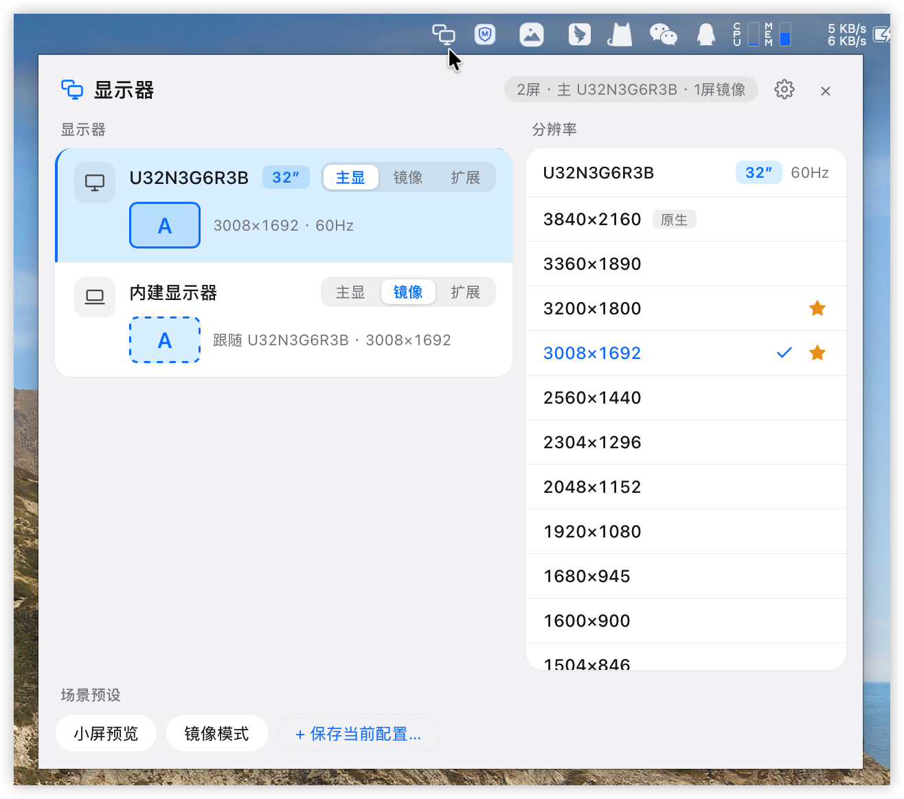
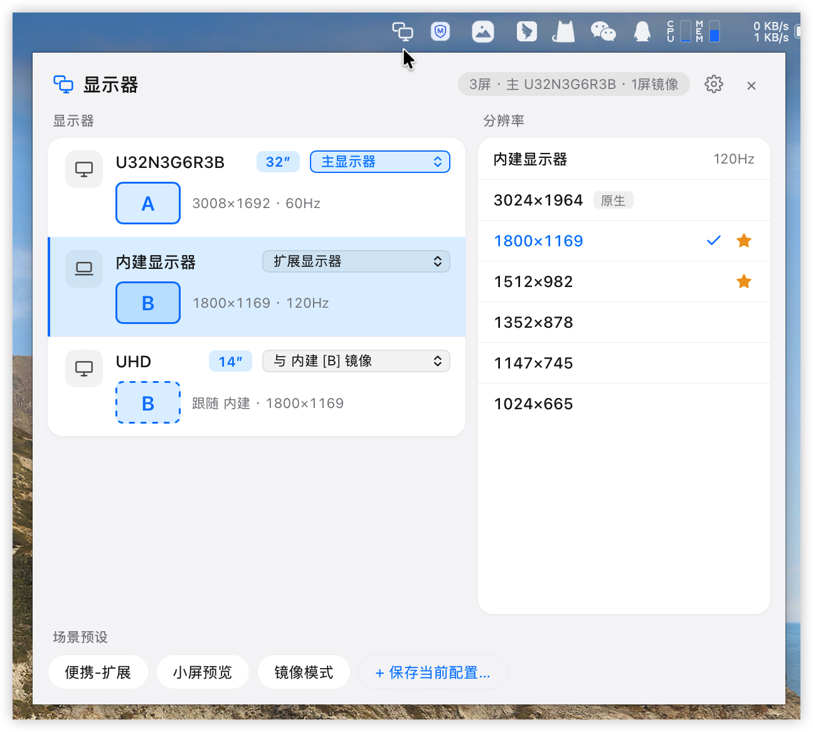
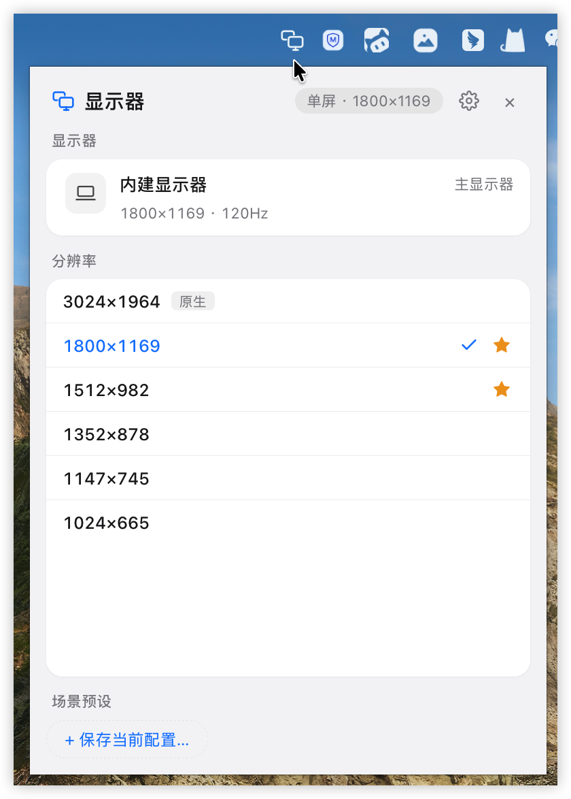

# 快切屏 DisplaySwitch

**Menu bar display switcher for macOS** · click to apply · never shows up in the Dock

[](LICENSE)

[](https://github.com/WitsonX/DisplaySwitch/releases/latest)

[简体中文](README.md) · **English**

---

Assign a role to every display (main / mirror another one / extended), pick a resolution mode, and save the whole arrangement as a setup you can restore in one click. It replaces the walk through System Settings → Displays — including partial mirroring on three or more displays, with a bilingual UI.

## Why this one

- **Just a menu bar icon**: no Dock entry, not in ⌘Tab. One click opens the panel, clicking away closes it, and every change applies immediately with no confirmation dialog.
- **Partial mirroring is expressible**: each display has its own role, so "external 1 mirrors external 2 while the built-in stays independent" is something you can actually select — not just "mirror everything" or "extend everything".
- **Setups restore a whole arrangement**: desk, meeting room, home — one click each. Setups remember which displays they belong to, so a setup whose display is unplugged simply does not appear rather than offering you something that cannot apply.
- **Nothing to install, no account**: displayplacer ships inside the app as a universal binary. Apart from the update check you trigger yourself, the app makes no network requests.
- **Auditable**: Apache-2.0, with unit tests for state parsing, settings I/O, language resolution and the release-URL allowlist.

## The scenario it exists for

Your external monitor has two inputs and is connected to both the Mac and another machine. When you switch the monitor to the other computer (without unplugging anything), macOS still believes the external display is attached. Flip to "built-in as main, external merely mirroring" in one click, and flip back when the monitor comes home — each of those states is just a saved setup.

## Download

Grab the `.dmg` from [Latest Release](https://github.com/WitsonX/DisplaySwitch/releases/latest); in mainland China the [Gitee releases page](https://gitee.com/Witson/DisplaySwitch/releases) may be faster (Gitee mirrors commits only — releases and attachments are published separately on each host).

**Portable build**: want the most advanced build right now? Grab the no-install package (a `.app` you just unzip) from the [canary release page](https://github.com/WitsonX/DisplaySwitch/releases/tag/canary). It is rebuilt on every push to master under a fixed file name — no version to pick — and the About card shows `Canary <commit>`. GitHub only, and it tracks unreleased mainline; stick to the stable build if you value your peace of mind.

> The build is not Apple-notarized, so the first launch shows "Apple cannot verify" — that is expected. Click Done in the dialog, then System Settings → Privacy & Security → **Open Anyway**. It only takes once.

## Screenshots

**Two displays: roles on the left, that display's resolution modes on the right** (the external U32N3G6R3B is main, the built-in panel mirrors it and follows its resolution, so both rows carry content letter A — the mirrored one dashed; the status pill reads "2 displays · main U32N3G6R3B · 1 mirrored")



**Three displays, partial mirror: the external UHD mirrors only the built-in panel, main stays independent** (with three or more displays the role control becomes a dropdown, and the mirror choice names its target "Mirror Built-in [B]"; the built-in row is selected, so the right column lists its 120 Hz modes with the "Native" tag, favorite stars and the active check)



**Single display (lid closed, or one panel attached) falls back to a one-column layout**, with resolutions listed under the display row and the status pill reading "One display · 1800×1169"



## Features

### Roles and mirroring

- One row per display. Two displays use a segmented "Main / Mirror / Extend" control; three or more switch to a dropdown (when there is more than one mirror candidate it lists them all, labelling the target with its content letter, e.g. "Mirror U2790B [A]", matching the A/B badges in the rows).
- Main is unique and transfers automatically when demoted; promoting a mirrored display to main swaps it with the previous one; a mirror target can only be the main or an extended display (no mirroring into a mirror).
- Roles are independent per display, which is what makes partial mirroring possible; a mirrored display follows its target's resolution and the right column explains it.
- External rows show the model name (U2790B / UHD …) and a physical size badge (27″ and the like); the built-in row always reads "Built-in Display" with no size badge. Sizes stay correct while mirroring.

### Resolutions and setups

- Left column lists displays (with content letters A/B/C; mirrored displays get the same letter in a dashed box), right column keeps the selected display's resolution list in place.
- Only modes you could actually pick in System Settings are offered: native aspect ratio (±2%) and either HiDPI or the native resolution, preferring the HiDPI variant, sorted by width descending.
- Each mode has a star; clicking it only favourites, it does not switch (favourited stars stay solid gold, unfavourited ones appear on hover). Favorites are recorded per display, pinned to the top by default while keeping their original order inside the group; mirrored displays show no star.
- A row of setup pills along the bottom applies a whole configuration by name, and hovering one shows its summary instantly (custom tooltip, no system delay). "+ Save current setup…" focuses the input as it opens — Enter saves, Esc cancels. The list starts empty; nothing is pre-seeded.

### Tray and interface

- Left click toggles the panel, clicking outside hides it, right click is Show Panel / Settings… / Quit (menu text follows the interface language).
- With a single display the panel narrows to one column, drops the content letters (there is nothing to compare against) and stops treating the display row as selectable (no pointer cursor, no selected state).
- Simplified Chinese / English, with a three-state segmented control "System / 简体中文 / English" and **System as the default**. Switching takes effect immediately, no restart: panel copy, generic display names (内建显示器 / Built-in Display), the Native badge, setup summaries, toasts, the native tray menu and backend error messages all follow.
- Settings opens from the gear in the header or the tray's "Settings…" (the "‹ Back" in the header returns to the main panel). General holds, in panel order: interface language, launch at login, and whether favourites pin to the top (the last two are macOS-style switches, control on the right, description under the title). Setups lists every saved arrangement — including ones whose displays are absent, greyed out as "Displays not connected" — and lets you rename or delete. About opens with the large app icon, name, version and purpose, then the displayplacer credit, the update check and the folder where setups live; below the card is a full-width Quit button that turns red on hover (with no Dock icon, it is the second way out besides the tray menu).

### System integration

- **Launch at login**: off by default; enabling it writes `~/Library/LaunchAgents/DisplaySwitch.plist` so the menu bar icon appears at login (still no Dock entry). The switch re-reads the real registration state every time settings opens, so deleting the plist by hand honestly shows as off.
- **Hotplug aware**: lid and plug events are debounced by 800ms and then refresh the list; the panel also refreshes whenever it gains focus.
- **Update check**: one "Updates" row in About. It only goes online when you click "Check for updates" (no automatic detection, no background polling), compares the latest release tag with the running version and reports in place (Not checked / Checking… / Up to date / New version v… / No releases yet / Check failed). When a newer version exists the button becomes "View release" and opens that source's release page in your browser — it never installs anything by itself.
- **displayplacer bundled**: a universal binary (arm64 + x86_64) plus its MIT license, inside the app — end users install nothing.

## Not supported

Windows, rotation, refresh-rate tuning, colour profiles.

## Documentation

For how mirror groups are read, why the main display has to be expressed through `origin`, or why the built-in panel's size does not come from `CGDisplayScreenSize` — and for building and hacking on it:

- **[doc/TECHNICAL.en.md](doc/TECHNICAL.en.md)** — architecture and the tray window, Tauri command reference, display identity/name/size sourcing, displayplacer parsing and spec generation, storage formats, i18n, update check, autostart, icon pipeline, development and release, known traps
- **[doc/ui-prototype/](doc/ui-prototype/)** — static interactive mockups (no dependencies, just open them), showing how the role model and the two-column layout were settled

The Chinese version is [doc/TECHNICAL.md](doc/TECHNICAL.md), maintained in step with this one.

In one line: **Tauri 2 (Rust backend) + Vue 3 (Options API) + Vite frontend, with the actual switching delegated to the bundled displayplacer**.

## Quick start

```bash
npm install
npm run tauri dev          # development run (hot reload)
npm run tauri build        # bundle, output in src-tauri/target/release/bundle/
cd src-tauri && cargo test # parser / settings / language / release-allowlist tests
```

Requirements (macOS + Xcode Command Line Tools + Node.js 18+ + a Rust toolchain) and the details are in [doc/TECHNICAL.en.md](doc/TECHNICAL.en.md#development). To look at the interface only, skip Rust entirely: `npm run dev` and open http://localhost:5173 — it runs on built-in mock data (noted in the footer, no real switching).

## Contributing

Issues and pull requests are welcome. For anything large, open an issue first to align on direction.

- Frontend components use **Options API** throughout — no `<script setup>`, no Composition API.
- Run `cargo test` in `src-tauri/` before committing.
- **Do not run `cargo fmt`**: this repository is not rustfmt-clean, so one run reformats a pile of unrelated files.
- Icon changes go through the generator and then `npx tauri icon` — see [doc/TECHNICAL.en.md](doc/TECHNICAL.en.md#icons).
- Releasing means syncing three version fields, and the release tag must be `v<version>` — see [doc/TECHNICAL.en.md](doc/TECHNICAL.en.md#bundling-and-releasing).

## Support the project

快切屏 is free and open source. If it saves you time:

- ⭐ Star this repository so more people find it
- 🐛 File an [issue](https://github.com/WitsonX/DisplaySwitch/issues) with a bug report or a feature idea

## License

[Apache License 2.0](LICENSE)

## Acknowledgements

- [displayplacer](https://github.com/jakehilborn/displayplacer) — MIT-licensed macOS display CLI; every switch in this app is carried out by it, and its binary is bundled with the app
- [Tauri](https://tauri.app/) — a light and secure desktop shell
- [Vue](https://vuejs.org/) — the frontend framework
