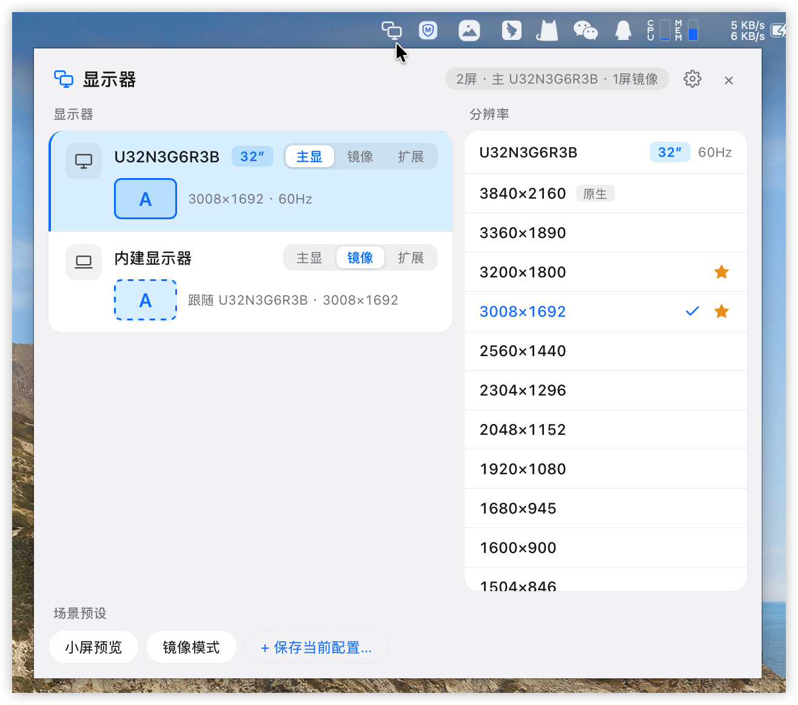
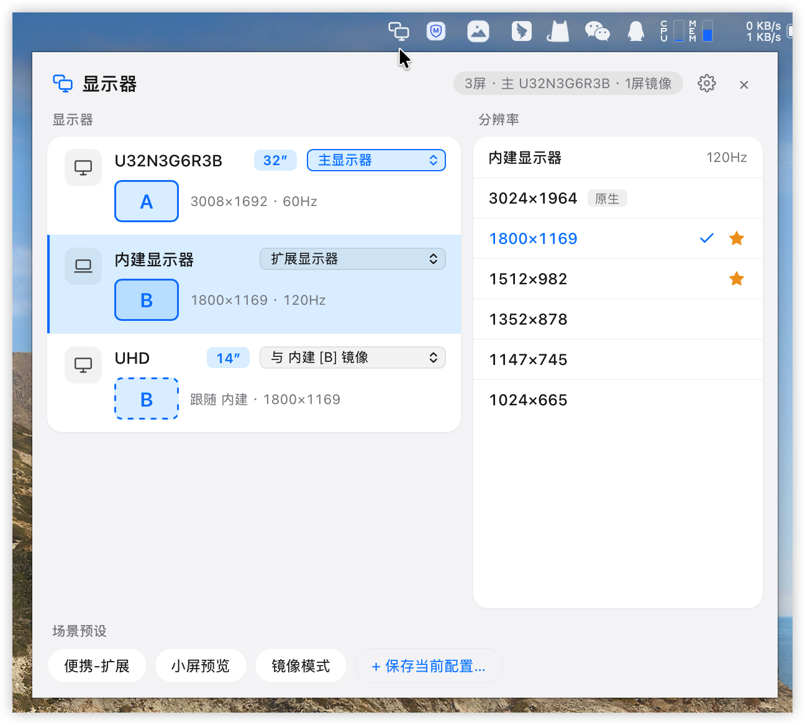
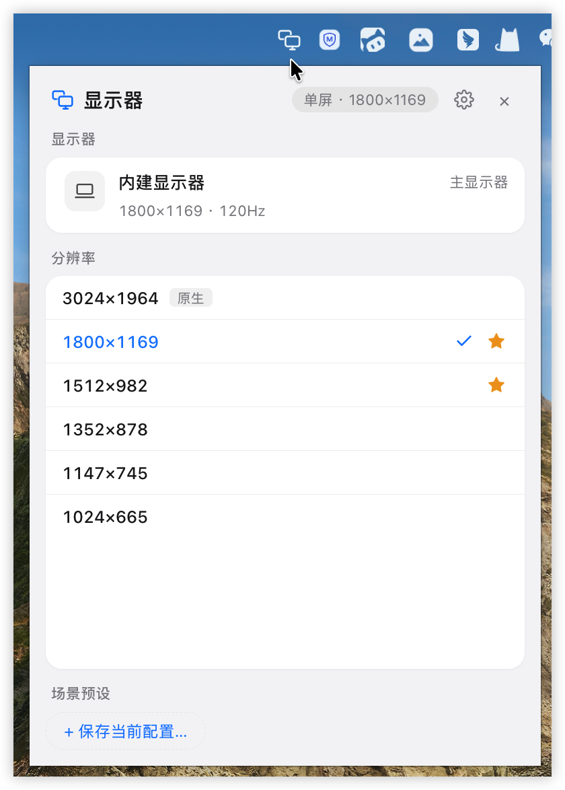

# 快切屏 DisplaySwitch

**macOS 菜单栏显示器切换工具** · 点选即生效 · 不进程序坞

[](LICENSE)

[](https://github.com/WitsonX/DisplaySwitch/releases/latest)

**简体中文** · [English](README.en.md)

---

给每台显示器指定角色（主显示器 / 与某屏镜像 / 扩展），点选分辨率档位，并把整套场景存成预设随时恢复。替代反复进出「系统设置 → 显示器」的繁琐流程——支持三屏及以上的部分镜像组合，界面中英双语。

## 为什么选它

- **只有菜单栏那一枚图标**：不进程序坞、不占 ⌘Tab，点一下就出、点外面就收，切换全部点选即时生效，没有确认弹窗。
- **能表达部分镜像**：每屏的角色各自独立，所以「外接 1 只镜像外接 2、内建保持独立」这类组合点得出来，不再只有「全部镜像 / 全部扩展」两种状态。
- **场景预设一键恢复**：工位、会议室、家里各存一套，点名字直接应用；预设按显示器记录，那块屏没接入时方案自动不出现，不会给你一条切不通的配置。
- **零安装、零账号**：displayplacer 已经作为 universal 二进制打进 App，终端用户什么都不用装；除了你主动点「检查更新」，不发任何网络请求。
- **开源可审**：Apache-2.0，状态解析、设置读写、语言与发布页白名单都有单元测试，欢迎逐条读源码。

## 核心场景

外接显示器有双输入、同时接着 Mac 和另一台电脑。显示器切给另一台电脑用时（不拔线），Mac 仍认为外接屏连着。此时一键切到「内置屏为主、外接只是镜像」的模式，显示器收回时一键切回——这两种状态各存成一个场景预设即可。

## 下载

从 [Latest Release](https://github.com/WitsonX/DisplaySwitch/releases/latest) 下载 `.dmg`；国内网络也可以从 [Gitee 发行版](https://gitee.com/Witson/DisplaySwitch/releases) 拿（Gitee 是镜像仓库，Release 与附件不跟着镜像走，两边是分别发的）。

> **当前还没有发布版本**。要现在就用，照下面「快速上手」自己 `npm run tauri build`，成品在 `src-tauri/target/release/bundle/dmg/`。

> 安装包未走 Apple 公证，首次打开提示「Apple 无法验证」属固定流程：弹窗点「完成」→「系统设置 → 隐私与安全性 → 安全性」里点**「仍要打开」**，放行只需一次。

## 界面

**双屏：左列角色，右列该屏的分辨率档位**（外接 U32N3G6R3B 为主显，内建显示器与它镜像、分辨率跟随，两屏的内容字母同为虚线/实线 A；状态胶囊「2屏 · 主 U32N3G6R3B · 1屏镜像」）



**三屏部分镜像：外接 UHD 只镜像内建，主屏保持独立**（三屏及以上角色改用下拉，镜像选项带目标屏字母「与 内建 [B] 镜像」；选中内建屏后右列是它的 120Hz 档位，「原生」标签、收藏星标与生效勾选都在）



**单屏（合盖或只带一块屏）自动退回单列布局**，分辨率列表直接放在显示器行下方，状态胶囊变成「单屏 · 分辨率」



## 功能

### 角色与镜像

- 每台显示器一行，双屏用分段按钮「主显 / 镜像 / 扩展」，三屏及以上改用下拉（镜像候选多于一个时直接列全，选项带目标屏的内容字母如「与 U2790B [A] 镜像」，与行内 A/B 示意对应）
- 主显示器全局唯一，降级时自动移交；镜像屏升为主显时与原主屏互换角色；镜像目标只能是主屏或扩展屏（不套娃）
- 每屏角色各自独立，因此支持部分镜像组合；镜像屏的分辨率跟随目标屏，右列显示「跟随」说明
- 外接屏行内显示型号名（U2790B / UHD …）与物理尺寸徽章（27″ 这类），内建屏固定显示「内建显示器」且不带尺寸徽章；尺寸在镜像状态下也保持准确

### 分辨率与预设

- 左列显示器列表（含内容示意字母 A/B/C，镜像屏为虚线同款字母），右列常驻所选屏的分辨率列表
- 只列出系统设置里真能选到的档位：与原生宽高比一致且为 HiDPI 或原生分辨率，同分辨率优先 HiDPI，按宽度降序
- 每档尾部一颗星，点星只收藏不切换（已收藏常显实心金色，未收藏悬浮该档才显出轮廓）；收藏按显示器分别记录，默认把已收藏的档位置顶，置顶组内仍按原顺序排；镜像屏不显示星
- 底部通栏一行预设胶囊，点名字直接应用整套配置，鼠标移上去即刻显示该预设内容摘要（自绘 tooltip，不等系统延迟）；「+ 保存当前配置…」点开即聚焦输入框，回车保存、Esc 取消；预设初始为空，不预置默认方案

### 托盘与界面

- 左键点击弹出/收起面板、点面板外任意处自动隐藏，右键是 显示面板 / 设置… / 退出（菜单文案跟着界面语言）
- 单屏场景自动收窄为单列布局，不显示内容示意字母（只有一块屏，没有可比对的内容），显示器行也不作为可选项（光标不变手型、点击无选中态）
- 简体中文 / English，设置里三态分段「跟随系统 / 简体中文 / English」，**默认跟随 macOS 系统语言**；切换即时生效、不用重启：面板文案、显示器通用名（内建显示器 / Built-in Display）、档位「原生 / Native」标签、预设摘要、提示气泡、托盘右键菜单和后端错误信息全部跟着换
- 设置面板从右上角齿轮或托盘右键「设置…」进入（顶栏「‹ 返回」回到主面板）：「通用」区按面板顺序是界面语言、登录 macOS 时自动启动、收藏是否置顶（后两项是 macOS 风格滑动开关，控件靠右、说明在标题下方）；「已存方案」列出全部方案（含未接入的，以灰色「显示器未接入」标注），可改名、删除；「关于」以 App 大图标 + 名称版本 + 用途开头，下面接 displayplacer 致谢、检查更新与方案存放路径，卡片下面一枚整宽「退出快切屏」按钮（悬浮转红；没有 Dock 图标后，托盘右键「退出」之外的第二个退出入口）

### 系统集成

- **自启动**：默认关闭，开启后写 `~/Library/LaunchAgents/DisplaySwitch.plist`，登录即出现在菜单栏（仍不进程序坞）；开关状态每次进设置都回读系统真实注册结果，手动删掉 plist 也会如实显示为未开启
- **热插拔感知**：合盖/开盖/插拔后防抖 800ms 自动刷新列表；面板获得焦点时也会刷新一次
- **检查更新**：「关于」里一行「更新」，点「检查更新」才联网（不自动检测、不后台轮询），比对最新 Release 的 tag 与当前版本，结果就地显示在行内（未检查 / 正在检查… / 已是最新版本 / 发现新版本 v… / 暂无发布版本 / 检查失败，请重试）；发现新版按钮变成「打开发布页」，用系统浏览器打开对应源的 Release 页手动下载，不自动安装
- **displayplacer 内嵌**：universal 二进制（arm64 + x86_64）与 MIT LICENSE 一起打进 App，终端用户无需安装

## 暂不支持

Windows 支持、旋转、刷新率微调、色彩配置文件。

## 技术文档

想知道「镜像组是怎么读出来的」「主显示器为什么要靠 origin 表达」「为什么内建屏的尺寸不信 `CGDisplayScreenSize`」，或者要跑起来改代码，看这里：

- **[doc/TECHNICAL.md](doc/TECHNICAL.md)** — 技术说明：架构与托盘窗口、Tauri 命令清单、显示器身份/名称/尺寸来源、displayplacer 状态解析与 spec 生成、存储格式、国际化、检查更新、自启动、图标生成、开发与打包、已知坑
- **[doc/ui-prototype/](doc/ui-prototype/)** — 纯静态可交互界面草图（无依赖，双击即看），角色模型与左右结构布局的定稿过程

英文版见 [doc/TECHNICAL.en.md](doc/TECHNICAL.en.md)，与中文同步维护。

一句话概括技术选型：**Tauri 2（Rust 后端）+ Vue 3（Options API）+ Vite 前端，切换动作交给内嵌的 displayplacer**。

## 快速上手

```bash
npm install
npm run tauri dev          # 开发运行（热重载）
npm run tauri build        # 打包，产物在 src-tauri/target/release/bundle/
cd src-tauri && cargo test # 解析器 / 设置 / 语言 / 发布页白名单单元测试
```

环境要求（macOS + Xcode Command Line Tools + Node.js 18+ + Rust 工具链）与逐项细节见 [doc/TECHNICAL.md](doc/TECHNICAL.md#开发与调试)。只想看界面可以不装 Rust：`npm run dev` 打开 http://localhost:5173，走内置假数据（底部有提示，不接入真实切换）。

## 贡献

欢迎提 Issue 与 PR。较大改动建议先开 Issue 讨论方向。

- 前端组件统一使用 **Options API**，不使用 `<script setup>` / Composition API
- 提交前在 `src-tauri/` 下跑 `cargo test` 确认无回归
- **不要跑 `cargo fmt`**：本仓库不是 rustfmt-clean，一次会顺手重排一堆无关文件
- 改图标要重跑生成器再 `npx tauri icon`，步骤见 [doc/TECHNICAL.md](doc/TECHNICAL.md#图标)
- 发版要同步三处版本号，Release tag 必须是 `v<version>`，见 [doc/TECHNICAL.md](doc/TECHNICAL.md#打包与发布)

## 支持项目

快切屏免费且开源。如果它帮到了你：

- ⭐ Star 本仓库，让更多人发现它
- 🐛 提 [Issue](https://github.com/WitsonX/DisplaySwitch/issues) 反馈问题或建议功能

## 许可证

[Apache License 2.0](LICENSE)

## 致谢

- [displayplacer](https://github.com/jakehilborn/displayplacer) — MIT 开源的 macOS 显示器命令行工具，本项目的切换动作全部由它落地，二进制随 App 内嵌分发
- [Tauri](https://tauri.app/) — 轻量且安全的桌面壳
- [Vue](https://vuejs.org/) — 前端框架
